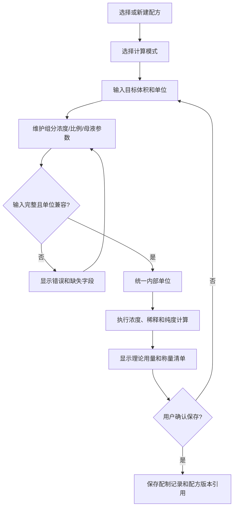
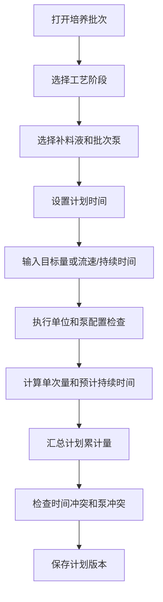
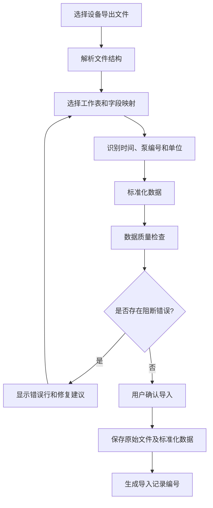
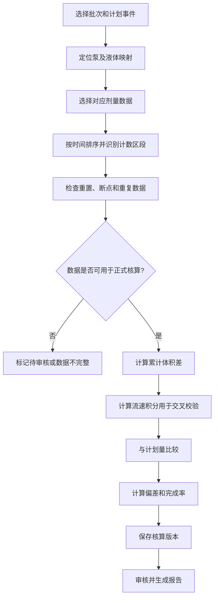

# 细胞培养基配制与补料剂量核算软件 V1.0
## 软件概要设计说明书

**文档版本：** V1.0  
**对应软件：** 细胞培养基配制与补料剂量核算软件 V1.0  
**文档性质：** 软件概要设计  
**运行平台：** Windows 桌面端  
**建议技术栈：** Python、PySide6、SQLite、Pandas、OpenPyXL、PyInstaller

---

## 1. 文档目的

本文档依据《软件功能开发计划书》，将软件功能进一步转化为可实施的系统设计，明确系统分层、功能模块、核心业务流程、数据模型、计算服务、文件导入规则、界面导航和异常处理要求，为后续详细设计、编码、测试和软件著作权材料准备提供依据。

本文中的数据字段和文件格式为首版建议设计。my-Control 与 Dose Monitor 的真实导出格式尚需通过设备样例文件验证，正式开发时应以实际文件和设备说明为准。

## 2. 系统总体设计

### 2.1 系统定位与边界

本软件是独立运行的 Windows 桌面辅助计算和数据管理软件。软件通过用户选择的 CSV/Excel 文件导入泵校准及剂量监测数据，完成配方计算、补料计划管理、实际添加量核算、批次追溯和报告生成。

V1.0 不直接连接或控制生物反应器、补料泵或其他现场设备，不下发启停、转速和流量控制指令。

### 2.2 总体架构

系统采用分层、模块化设计：

```text
┌─────────────────────────────────────────────────────┐
│                    用户界面层                         │
│ 首页 | 基础数据 | 配方 | 配制计算 | 批次 | 补料计划   │
│ 泵校准 | 剂量导入 | 剂量核算 | 异常审核 | 报告 | 设置 │
└─────────────────────────┬───────────────────────────┘
                          │
┌─────────────────────────▼───────────────────────────┐
│                    业务服务层                         │
│ 配方服务 | 单位换算 | 配制计算 | 批次服务 | 计划服务 │
│ 校准服务 | 文件导入 | 剂量核算 | 异常处理 | 报告服务 │
└─────────────────────────┬───────────────────────────┘
                          │
┌─────────────────────────▼───────────────────────────┐
│                    数据处理层                         │
│ CSV/XLSX解析 | 字段映射 | 时间解析 | 数据标准化      │
│ 重复检查 | 计数器分段 | 数据质量检查 | 计算数据集     │
└─────────────────────────┬───────────────────────────┘
                          │
┌─────────────────────────▼───────────────────────────┐
│                    数据访问层                         │
│ SQLite Repository | 事务管理 | 版本快照 | 操作日志   │
└─────────────────────────┬───────────────────────────┘
                          │
┌─────────────────────────▼───────────────────────────┐
│                    本地存储层                         │
│ SQLite数据库 | 原始文件归档 | 报告文件 | 备份文件     │
└─────────────────────────────────────────────────────┘
```

### 2.3 模块依赖关系

- 基础数据管理为配方、批次、泵校准和剂量核算提供统一字典。
- 配方管理为配制计算和批次建档提供配方及版本信息。
- 批次管理关联培养阶段、配方版本、泵配置、补料计划和剂量数据。
- 泵校准管理为补料计划的目标流速估算提供校准曲线。
- Dose Monitor 导入模块为实际剂量核算提供标准化时间序列数据。
- 剂量核算模块读取补料计划、批次泵映射和标准化剂量数据。
- 异常审核模块管理导入、计算及人工修正过程中产生的异常。
- 报告模块读取已保存的业务数据和核算结果，不直接修改业务数据。

## 3. 功能模块设计

### 3.1 模块清单

| 模块编号 | 模块名称 | 主要输入 | 主要输出 |
|---|---|---|---|
| M01 | 首页与工作台 | 批次、导入、异常、核算数据 | 概览和待处理事项 |
| M02 | 基础数据管理 | 组分、液体、泵、反应器信息 | 基础数据档案 |
| M03 | 配方管理 | 配方头信息、组分明细 | 配方及版本快照 |
| M04 | 配制计算 | 目标体积、浓度、纯度、母液参数 | 理论用量、称量清单 |
| M05 | 工艺液管理 | Feed、碱液、消泡剂信息 | 液体档案 |
| M06 | 批次管理 | 批次信息、工艺阶段、培养参数 | 批次档案 |
| M07 | 补料计划 | 阶段、时间、目标量、泵和液体 | 补料事件及计划汇总 |
| M08 | 泵校准 | my-Control 文件、校准点 | 校准记录和曲线 |
| M09 | 剂量数据导入 | Dose Monitor 文件 | 标准化剂量数据 |
| M10 | 实际剂量核算 | 计划、泵映射、剂量数据 | 实际量、偏差和完成率 |
| M11 | 异常审核 | 异常记录、人工说明和修订 | 审核状态和修订记录 |
| M12 | 报表与系统管理 | 业务记录、核算结果、系统配置 | Excel/PDF、备份和日志 |

### 3.2 首页与工作台

首页显示：
- 批次总数、进行中批次、已完成批次。
- 最近创建或更新的批次。
- 最近导入的设备文件。
- 待审核剂量结果和未解决异常。
- 最近生成的报告。

首页仅展示摘要信息。点击摘要进入对应模块，不在首页直接修改原始剂量数据。

### 3.3 配方管理与配制计算

配方编辑页面分为：
1. 配方基本信息。
2. 组分明细表。
3. 计算模式选择。
4. 目标体积和单位设置。
5. 计算结果预览。
6. 保存版本和导出称量清单。

计算服务应与界面分离。用户改变输入参数时，界面调用计算服务并展示结果；只有用户确认保存后，才创建正式配制记录。

### 3.4 批次管理

批次详情页建议采用标签页：
- 基本信息。
- 培养阶段与参数。
- 配方与配制记录。
- 泵与液体配置。
- 补料计划。
- 设备数据导入。
- 实际剂量核算。
- 异常与审核。
- 报告与附件。

每个批次保存当时使用的配方版本、泵—液体绑定关系和补料计划版本，避免后续主数据修改影响历史批次。

### 3.5 补料计划

补料计划由计划主表和多个补料事件组成。每个事件至少包含批次、工艺阶段、计划时间、液体、泵、单次目标量、目标流速、预计持续时间和状态。

计划累计量由有效补料事件汇总得出。用户修改事件时，系统重新计算计划累计量，并保存计划版本。

### 3.6 泵校准

校准模块包含：
- 泵列表。
- 校准记录列表。
- 文件导入及字段映射。
- 校准点数据表。
- 转速/设置值—流量曲线。
- 当前有效校准记录。

校准数据应保留来源文件和导入记录。校准曲线只在实际测量点覆盖范围内进行插值；超出范围时显示警告。

### 3.7 剂量导入

导入向导建议分为五步：

1. 选择文件：选择 CSV/XLSX 文件，可选择多个文件。
2. 选择工作表：Excel 文件选择工作表及数据起始行。
3. 字段映射：将源文件列映射到标准字段。
4. 数据预览：展示解析后的时间、泵编号、流速、累计体积和单位。
5. 质量检查与确认：显示错误、警告、重复记录和数据范围，用户确认后保存。

导入过程不应静默删除异常行。无法解析的行应进入错误明细，并允许用户下载或导出错误清单。

### 3.8 实际剂量核算

核算页面建议分为：
- 核算条件：批次、泵、液体、计划事件和时间窗口。
- 数据质量摘要：数据点数、覆盖时间、缺失区间、计数器重置。
- 核算结果：累计体积差、流速积分、计划量、偏差量、偏差率、完成率。
- 趋势图：流速—时间、累计体积—时间。
- 异常与审核：异常说明、审核状态和修订历史。

核算结果应显示所采用的数据源和计算口径，避免将估算结果误显示为实测结果。

## 4. 核心业务流程设计

### 4.1 配方计算流程



### 4.2 补料计划流程



### 4.3 设备数据导入流程



### 4.4 实际剂量核算流程



## 5. 数据库概要设计

### 5.1 数据库设计原则

- 使用 SQLite，采用外键约束和事务。
- 主键建议使用 UUID 或稳定的文本编号。
- 时间字段统一保存 ISO 8601 格式，并明确时区策略。
- 数值字段保存原始精度，显示舍入与计算精度分离。
- 原始文件独立归档，数据库保存文件路径、哈希和导入元数据。
- 配方、计划、校准和核算结果均应可追溯到版本。
- 业务数据原则上不物理删除，优先采用停用或逻辑删除。

### 5.2 主要数据表及字段

#### 5.2.1 `batch_info` 批次主表

| 字段 | 类型建议 | 说明 |
|---|---|---|
| batch_id | TEXT PK | 批次唯一编号 |
| batch_code | TEXT UNIQUE | 用户可读批次编号 |
| project_name | TEXT | 项目名称 |
| culture_system | TEXT | 培养体系 |
| reactor_id | TEXT | 反应器编号 |
| working_volume_ml | REAL | 工作体积 |
| start_time | TEXT | 开始时间 |
| end_time | TEXT | 结束时间 |
| status | TEXT | 草稿/进行中/已完成/已关闭 |
| notes | TEXT | 备注 |
| created_at | TEXT | 创建时间 |
| created_by | TEXT | 创建人 |

#### 5.2.2 `formula_info` 配方主表

| 字段 | 类型建议 | 说明 |
|---|---|---|
| formula_id | TEXT PK | 配方编号 |
| formula_code | TEXT | 配方代码 |
| formula_name | TEXT | 配方名称 |
| formula_type | TEXT | 基础培养基/浓缩培养基/Feed/其他 |
| version_no | INTEGER | 版本号 |
| status | TEXT | 草稿/已发布/停用 |
| effective_date | TEXT | 生效日期 |
| change_note | TEXT | 版本变更说明 |
| created_at | TEXT | 创建时间 |

#### 5.2.3 `formula_detail` 配方组分表

| 字段 | 类型建议 | 说明 |
|---|---|---|
| detail_id | TEXT PK | 明细编号 |
| formula_id | TEXT FK | 配方编号 |
| component_id | TEXT FK | 组分编号 |
| target_concentration | REAL | 目标浓度 |
| concentration_unit | TEXT | 浓度单位 |
| molecular_weight | REAL | 使用的分子量快照 |
| purity_fraction | REAL | 纯度小数值 |
| source_type | TEXT | 直接称量/母液 |
| stock_concentration | REAL | 母液浓度 |
| stock_unit | TEXT | 母液单位 |
| sort_order | INTEGER | 显示顺序 |

#### 5.2.4 `preparation_record` 配制记录表

| 字段 | 类型建议 | 说明 |
|---|---|---|
| preparation_id | TEXT PK | 配制记录编号 |
| batch_id | TEXT FK NULL | 关联批次，可为空 |
| formula_id | TEXT FK | 配方版本 |
| target_volume | REAL | 目标体积 |
| volume_unit | TEXT | 体积单位 |
| theoretical_amount | REAL | 理论用量 |
| corrected_amount | REAL | 纯度修正后用量 |
| actual_weighed_amount | REAL | 实际称量量 |
| actual_final_volume | REAL | 实际定容体积 |
| calculated_actual_concentration | REAL | 反算浓度 |
| prepared_at | TEXT | 配制时间 |
| operator | TEXT | 操作人员 |

#### 5.2.5 `pump_info` 泵档案表

| 字段 | 类型建议 | 说明 |
|---|---|---|
| pump_id | TEXT PK | 泵唯一编号 |
| pump_code | TEXT UNIQUE | 泵/通道显示编号 |
| pump_name | TEXT | 泵名称 |
| pump_type | TEXT | 泵类型 |
| flow_unit | TEXT | 默认流速单位 |
| status | TEXT | 启用/停用 |
| notes | TEXT | 备注 |

#### 5.2.6 `batch_pump_mapping` 批次泵液体映射表

| 字段 | 类型建议 | 说明 |
|---|---|---|
| mapping_id | TEXT PK | 映射编号 |
| batch_id | TEXT FK | 批次 |
| pump_id | TEXT FK | 泵 |
| liquid_id | TEXT FK | 液体 |
| valid_from | TEXT | 生效时间 |
| valid_to | TEXT NULL | 失效时间 |
| mapping_note | TEXT | 说明 |

该表支持同一设备泵在不同批次绑定不同液体。映射应按批次保存，不应仅依赖全局默认关系。

#### 5.2.7 `pump_calibration` 校准记录表

| 字段 | 类型建议 | 说明 |
|---|---|---|
| calibration_id | TEXT PK | 校准记录编号 |
| pump_id | TEXT FK | 泵编号 |
| calibration_date | TEXT | 校准日期 |
| source_file_id | TEXT | 来源导入记录 |
| calibration_status | TEXT | 有效/过期/待审核 |
| calibration_method | TEXT | 校准方法 |
| notes | TEXT | 备注 |

#### 5.2.8 `pump_calibration_point` 校准点表

| 字段 | 类型建议 | 说明 |
|---|---|---|
| point_id | TEXT PK | 校准点编号 |
| calibration_id | TEXT FK | 校准记录 |
| setpoint_value | REAL | 转速/设置值 |
| setpoint_unit | TEXT | 设置值单位 |
| measured_flow | REAL | 实测流速 |
| flow_unit | TEXT | 流速单位 |
| measured_volume | REAL NULL | 实测体积 |
| run_duration | REAL NULL | 运行时长 |
| duration_unit | TEXT NULL | 时长单位 |

#### 5.2.9 `feed_plan` 补料计划主表

| 字段 | 类型建议 | 说明 |
|---|---|---|
| plan_id | TEXT PK | 计划编号 |
| batch_id | TEXT FK | 批次 |
| version_no | INTEGER | 计划版本 |
| status | TEXT | 草稿/已确认/已完成/停用 |
| created_at | TEXT | 创建时间 |
| created_by | TEXT | 创建人 |

#### 5.2.10 `feed_plan_event` 补料事件表

| 字段 | 类型建议 | 说明 |
|---|---|---|
| event_id | TEXT PK | 事件编号 |
| plan_id | TEXT FK | 计划编号 |
| stage_id | TEXT FK | 工艺阶段 |
| liquid_id | TEXT FK | 补料液/工艺液 |
| pump_id | TEXT FK | 关联泵 |
| planned_start | TEXT | 计划开始时间 |
| planned_end | TEXT | 计划结束时间 |
| planned_volume_ml | REAL | 单次计划量 |
| target_flow_ml_h | REAL | 目标流速 |
| duration_h | REAL | 预计持续时间 |
| concentration_value | REAL NULL | 液体浓度 |
| concentration_unit | TEXT NULL | 浓度单位 |
| notes | TEXT | 备注 |

#### 5.2.11 `import_record` 文件导入记录表

| 字段 | 类型建议 | 说明 |
|---|---|---|
| import_id | TEXT PK | 导入编号 |
| batch_id | TEXT FK | 关联批次 |
| source_type | TEXT | my-Control/Dose Monitor |
| original_filename | TEXT | 原始文件名 |
| archived_path | TEXT | 归档路径 |
| file_hash | TEXT | 文件哈希 |
| imported_at | TEXT | 导入时间 |
| imported_by | TEXT | 导入人员 |
| row_count | INTEGER | 数据行数 |
| success_count | INTEGER | 成功行数 |
| error_count | INTEGER | 错误行数 |
| mapping_config | TEXT | 字段映射配置快照 |
| import_status | TEXT | 成功/部分成功/失败 |

#### 5.2.12 `dose_data_normalized` 标准化剂量数据表

| 字段 | 类型建议 | 说明 |
|---|---|---|
| dose_row_id | TEXT PK | 数据行编号 |
| import_id | TEXT FK | 导入记录 |
| batch_id | TEXT FK | 批次 |
| pump_id | TEXT FK | 泵 |
| timestamp_utc | TEXT | 标准化时间 |
| flow_rate | REAL NULL | 流速 |
| flow_unit | TEXT NULL | 流速单位 |
| total_volume | REAL NULL | 累计体积 |
| volume_unit | TEXT NULL | 体积单位 |
| pump_status | TEXT NULL | 泵状态 |
| counter_segment | INTEGER | 累计计数区段 |
| quality_flags | TEXT | 质量标记 |

#### 5.2.13 `dose_calculation` 核算结果表

| 字段 | 类型建议 | 说明 |
|---|---|---|
| calculation_id | TEXT PK | 核算编号 |
| batch_id | TEXT FK | 批次 |
| event_id | TEXT FK NULL | 补料事件 |
| pump_id | TEXT FK | 泵 |
| liquid_id | TEXT FK | 液体 |
| time_start | TEXT | 核算开始时间 |
| time_end | TEXT | 核算结束时间 |
| planned_volume_ml | REAL NULL | 计划量 |
| actual_volume_ml | REAL NULL | 实际量 |
| flow_integral_ml | REAL NULL | 流速积分量 |
| deviation_ml | REAL NULL | 偏差量 |
| deviation_percent | REAL NULL | 偏差率 |
| completion_percent | REAL NULL | 完成率 |
| calculation_method | TEXT | 核算方法 |
| quality_status | TEXT | 有效/估算/待审核/无效 |
| calculation_version | INTEGER | 计算版本 |
| calculated_at | TEXT | 计算时间 |

#### 5.2.14 `operation_log` 操作日志表

| 字段 | 类型建议 | 说明 |
|---|---|---|
| log_id | TEXT PK | 日志编号 |
| user_id | TEXT NULL | 操作用户 |
| action_type | TEXT | 操作类型 |
| object_type | TEXT | 对象类型 |
| object_id | TEXT | 对象编号 |
| before_value | TEXT NULL | 修改前内容 |
| after_value | TEXT NULL | 修改后内容 |
| reason | TEXT NULL | 修改原因 |
| created_at | TEXT | 操作时间 |

其他辅助表包括 `component_info`、`liquid_info`、`batch_stage`、`culture_parameter`、`dose_anomaly`、`report_record` 和 `user_info`。

## 6. 核心计算服务设计

### 6.1 单位换算服务

职责：
- 管理质量、体积、时间和浓度单位。
- 将输入转换到内部标准单位。
- 检查单位是否兼容。
- 对摩尔浓度与质量浓度换算检查分子量。

建议内部单位：
- 质量：g
- 体积：L
- 时间：h
- 质量浓度：g/L
- 摩尔浓度：mol/L
- 流速：mL/h 或统一换算为 L/h 后计算

### 6.2 配方计算服务

输入：
- 配方组分和目标浓度/比例。
- 目标配制体积。
- 原料纯度。
- 母液浓度及单位（如适用）。
- 分子量（摩尔浓度换算时必需）。

输出：
- 理论称量量。
- 纯度修正后称量量。
- 母液添加体积。
- 溶剂补足量。
- 单位换算说明。
- 输入完整性和计算警告。

### 6.3 泵校准服务

输入：
- 泵编号。
- 有效校准记录。
- 泵设置值/转速。

输出：
- 校准曲线。
- 测量区间内插值流速。
- 校准有效性和超范围警告。

插值公式：

\[
Q(x)=Q_1+\frac{x-x_1}{x_2-x_1}(Q_2-Q_1)
\]

若 \(x_1=x_2\)、校准点单位不一致或校准点不足，应拒绝计算或要求修正数据。

### 6.4 剂量核算服务

**累计体积差：**

\[
V_{\mathrm{actual}}=V_{\mathrm{end}}-V_{\mathrm{start}}
\]

仅在同一连续计数区段内计算。若存在计数器重置，先切分区段，再依据用户确认的重置时间和事件边界汇总。

**流速积分：**

\[
V_{\mathrm{flow}}=\sum_{i=1}^{n}
\frac{Q_i+Q_{i+1}}{2}\Delta t_i
\]

流速单位统一为 mL/h，时间差换算为 h。超过允许采样间隔的区间应标记为缺失，不应默认以直线跨越长时间断点。

**偏差与完成率：**

\[
\Delta V=V_{\mathrm{actual}}-V_{\mathrm{planned}}
\]

\[
E=\frac{\Delta V}{V_{\mathrm{planned}}}\times100\%
\]

\[
R=\frac{V_{\mathrm{actual}}}{V_{\mathrm{planned}}}\times100\%
\]

计划量为零或缺失时，偏差率和完成率设为不适用，不产生除零结果。

### 6.5 核算结果状态

建议使用以下状态：
- **有效：** 数据完整，核算规则明确。
- **估算：** 仅使用流速积分或其他替代数据源。
- **待审核：** 存在重置、断点、时间匹配或映射疑问。
- **无效：** 数据不足或存在无法解决的关键错误。

---

## 7. 文件导入与标准化设计

### 7.1 导入适配器

为不同设备建立独立导入适配器：

```text
importers/
├─ base_importer.py
├─ my_control_importer.py
├─ dose_monitor_importer.py
├─ csv_reader.py
├─ excel_reader.py
├─ field_mapper.py
├─ timestamp_parser.py
└─ validation.py
```

各适配器输出统一的内部数据对象，业务计算模块不直接依赖设备原始列名。

### 7.2 标准化剂量数据对象

```python
{
    "timestamp": "2026-01-01T08:00:00+00:00",
    "pump_code": "PUMP_01",
    "flow_rate": 10.0,
    "flow_unit": "mL/h",
    "total_volume": 100.0,
    "volume_unit": "mL",
    "pump_status": "RUN",
    "source_import_id": "IMPORT-0001"
}
```

以上为内部结构示例，实际时间、泵编号和字段必须来自用户导入文件，不应在生产数据中使用示例值替代真实数据。

### 7.3 导入校验分类

| 级别 | 典型情况 | 处理策略 |
|---|---|---|
| 阻断错误 | 时间戳无法解析、泵编号缺失、关键单位未知 | 不允许确认导入相关记录 |
| 警告 | 累计体积下降、采样间隔过长、流速积分差异大 | 可导入，但标记待审核 |
| 提示 | 可选状态字段缺失、文件名与批次名不一致 | 显示提示并允许继续 |

### 7.4 文件归档目录建议

```text
ApplicationData/
├─ database/
│  └─ cell_culture.db
├─ imports/
│  └─ BATCH-XXXX/
│     ├─ my_control/
│     └─ dose_monitor/
├─ reports/
│  └─ BATCH-XXXX/
├─ backups/
├─ templates/
└─ logs/
```

文件目录应允许用户在设置中查看或更改。数据库记录相对路径或受控路径，避免依赖某一台电脑的固定用户名目录。

## 8. 用户界面概要设计

### 8.1 主窗口布局

建议使用左侧导航栏、顶部工具区和中央内容区。

```text
┌────────────────────────────────────────────────────────────┐
│ 细胞培养基配制与补料剂量核算软件                 用户  设置 │
├──────────────┬─────────────────────────────────────────────┤
│ 首页         │ 当前批次：BATCH-XXXX                         │
│ 基础数据     │                                             │
│ 配方管理     │  批次状态      待审核异常      最近导入      │
│ 配制计算     │  ┌────────┐  ┌────────┐  ┌────────┐       │
│ 批次管理     │  │进行中  │  │  2项   │  │  3个   │       │
│ 补料计划     │  └────────┘  └────────┘  └────────┘       │
│ 泵校准       │                                             │
│ 剂量导入     │  计划与实际剂量对照                          │
│ 剂量核算     │  ┌─────────────────────────────────────┐   │
│ 异常审核     │  │ Feed A / Feed B / 碱液 / 消泡剂      │   │
│ 报告中心     │  └─────────────────────────────────────┘   │
│ 系统设置     │                                             │
│              │  最近批次             最近操作              │
└──────────────┴─────────────────────────────────────────────┘
```

### 8.2 关键页面交互要求

- 列表页面支持搜索、筛选、排序和分页。
- 表单页面区分必填项和可选项。
- 数值字段显示单位，不允许仅输入无单位的关键数值。
- 计算页面区分“计算预览”和“保存正式记录”。
- 导入页面提供字段映射预览和错误明细。
- 核算页面显示数据来源、计算方法和质量状态。
- 报告页面显示报告版本和生成时间。

## 9. 异常处理设计

### 9.1 异常分类

1. 输入异常：缺少必填值、数值格式错误、单位不兼容。
2. 配方异常：缺少分子量、纯度不合理、母液浓度缺失。
3. 计划异常：时间冲突、泵未绑定液体、目标量为负值。
4. 导入异常：文件损坏、列缺失、时间格式不支持、泵编号未知。
5. 剂量异常：累计体积下降、计数器重置、流速跳变、数据断点。
6. 追溯异常：批次已关闭、引用版本不存在、原始文件丢失。

### 9.2 人工修正原则

- 原始导入记录不可覆盖。
- 修正应形成独立修订记录。
- 修正必须填写原因。
- 修正后重新计算时生成新的核算版本。
- 旧核算结果保留并标记为已被新版本替代。
- 对待审核或无效数据，报告必须显示其状态和限制。

## 10. 安全、数据完整性与备份设计

- 数据库使用事务，避免中断导致部分写入。
- 启动时检查数据库文件可访问性。
- 提供手动备份和恢复功能。
- 备份至少包含数据库、原始导入文件和必要配置。
- 恢复前检查备份完整性，并提示恢复会覆盖或替换当前数据。
- 对关键操作写入日志。
- 用户密码如实现登录功能，应使用安全哈希算法保存，不保存明文密码。
- 对用于受监管生产或质量决策的场景，需另行开展法规适用性评估和计算机化系统验证；本设计不构成法规符合性声明。

## 11. 非功能性要求

| 类别 | 设计要求 |
|---|---|
| 平台 | 支持目标 Windows 10/11 环境，最终以实际部署测试为准 |
| 性能 | 常规配方计算即时返回；大文件导入显示进度 |
| 稳定性 | 长时间导入和报告生成不得阻塞主界面 |
| 可维护性 | UI、业务服务、数据访问和导入适配器分离 |
| 可扩展性 | 设备文件格式通过新增适配器扩展 |
| 可追溯性 | 关键数据保留来源、版本、操作者和时间 |
| 可用性 | 错误信息具体，提供可执行的处理建议 |
| 可移植性 | 本地数据目录可配置，支持完整备份和恢复 |

## 12. 测试设计概要

### 12.1 单元测试

- 单位换算。
- 目标浓度计算。
- 纯度修正。
- 母液稀释。
- 泵校准插值。
- 累计体积差。
- 梯形积分。
- 偏差率和完成率。
- 计数器分段识别。

### 12.2 集成测试

- 配方保存后用于配制计算。
- 配方版本关联到批次。
- 批次泵映射关联补料计划。
- my-Control 文件导入后生成校准记录。
- Dose Monitor 文件导入后生成标准化数据。
- 计划、剂量数据和核算结果正确关联。
- 报告正确读取并输出批次记录。

### 12.3 系统测试

- 软件安装、启动和退出。
- 多批次数据管理。
- 大文件导入及界面响应。
- 数据备份和恢复。
- 异常中断后的数据一致性。
- Excel/PDF 报告生成。
- 目标 Windows 环境兼容性。

## 13. 开发目录结构建议

```text
CellCultureDoseSoftware/
├─ main.py
├─ app/
│  ├─ ui/
│  │  ├─ main_window.py
│  │  ├─ dashboard/
│  │  ├─ master_data/
│  │  ├─ formula/
│  │  ├─ preparation/
│  │  ├─ batch/
│  │  ├─ feed_plan/
│  │  ├─ calibration/
│  │  ├─ dose_import/
│  │  ├─ dose_calculation/
│  │  ├─ anomaly/
│  │  └─ reports/
│  ├─ services/
│  ├─ models/
│  ├─ repositories/
│  ├─ importers/
│  ├─ exporters/
│  └─ utils/
├─ database/
├─ templates/
├─ tests/
├─ docs/
└─ resources/
```

## 14. 实施顺序与交付里程碑

| 里程碑 | 实施内容 | 交付结果 |
|---|---|---|
| D1 | 真实设备文件和计算样例确认 | 文件字段规范、计算口径确认表 |
| D2 | 数据库与桌面框架 | 可启动程序、数据库初始化 |
| D3 | 基础数据、配方和计算服务 | 配方管理及计算功能 |
| D4 | 批次和补料计划 | 批次档案和补料计划 |
| D5 | 校准和设备数据导入 | 两类文件导入功能 |
| D6 | 剂量核算和异常处理 | 核算结果、异常记录 |
| D7 | 报告、日志和备份 | 报告中心和数据保护 |
| D8 | 集成测试和发布 | 安装包、测试报告、用户手册 |

建议沿用开发计划书中的约 10–14 周初步估算，但应在 D1 完成真实文件评估后重新确认排期。

## 15. 开发前待确认事项

以下事项采用了保守的默认设计，但在编码前必须以实际设备数据或工艺要求确认：

1. my-Control 导出文件中，校准数据究竟是设置值、理论流量、实测流量还是校准后流量。
2. Dose Monitor 的累计体积是批次累计、单次累计，还是可能自动归零。
3. Dose Monitor 的流速是否已经应用设备校准参数。
4. 时间戳是否含时区，设备电脑与实验室记录时间是否一致。
5. 多泵是否可能在不同批次对应不同液体。
6. 补料计划时间窗口如何定义，实际补料跨越计划边界时如何分配。
7. 计数器重置、数据断点和手动补料如何确认与记录。
8. 需要使用的目标 Windows 版本和安装方式。
9. 是否需要登录、用户角色和审核流程。
10. 是否需要计算碱液/消泡剂的有效成分质量，还是仅核算体积。

## 16. 设计结论

本软件建议采用 Python + PySide6 + SQLite 的模块化 Windows 桌面架构，以培养批次为核心组织配方、配制记录、补料计划、泵校准、设备剂量数据和核算报告。

V1.0 的关键技术重点不是设备控制，而是：
- 配方计算和单位换算的准确性。
- 设备文件导入的可配置性。
- 泵校准状态与流速数据来源的正确区分。
- 累计体积重置和数据断点的可靠识别。
- 计划与实际剂量的可解释核算。
- 原始数据、人工修正和计算结果的完整追溯。

正式编码前，应优先完成真实 my-Control、Dose Monitor 文件样例验证，并形成字段映射与计算口径确认记录。

---

**文档结束**
